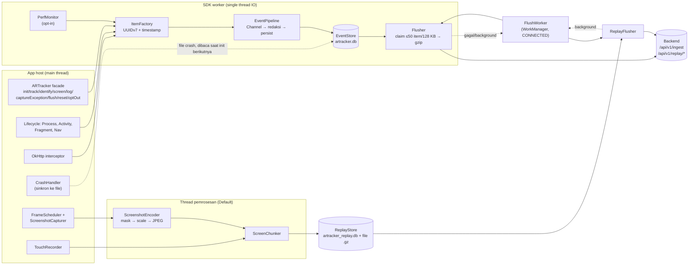
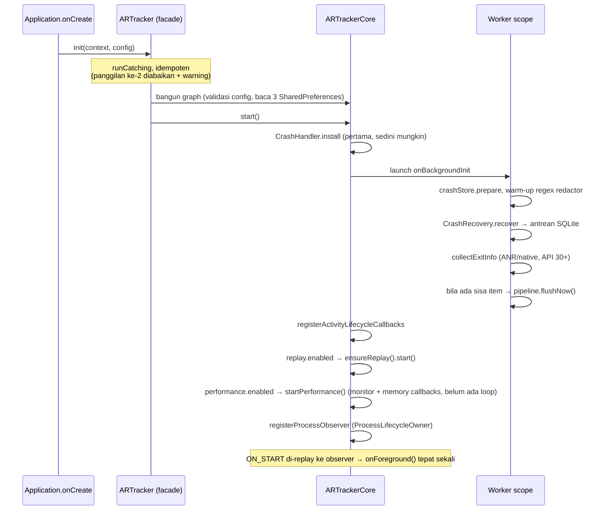
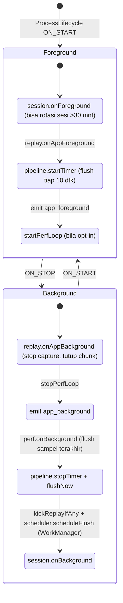
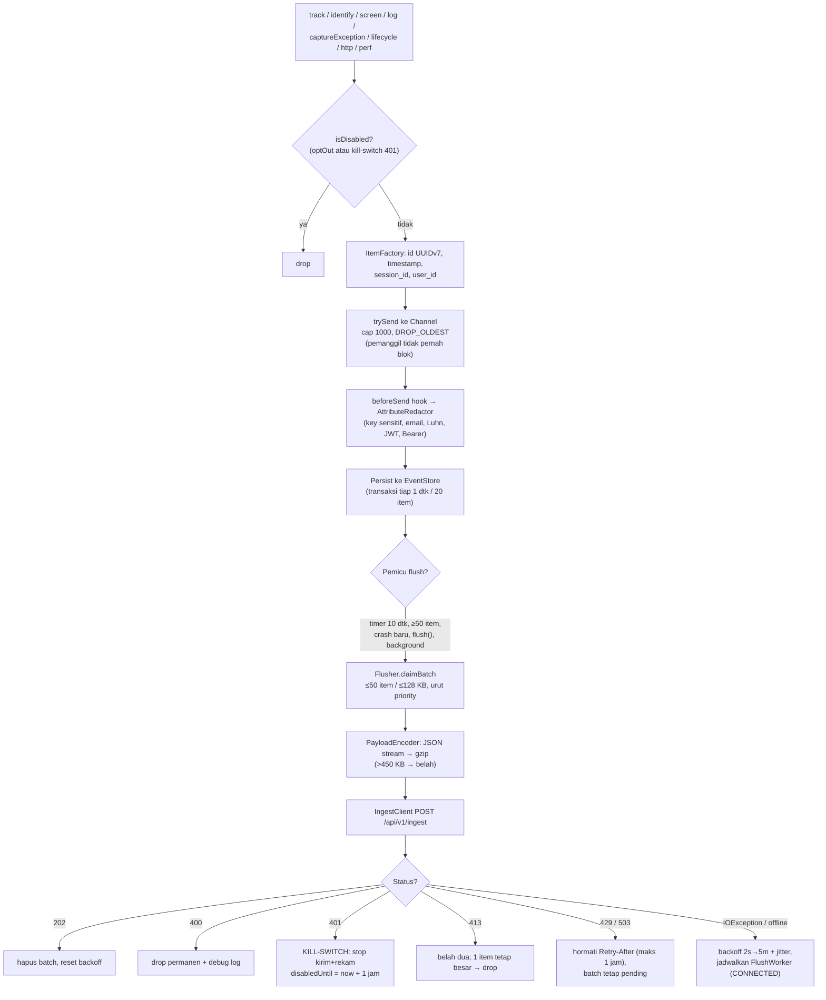
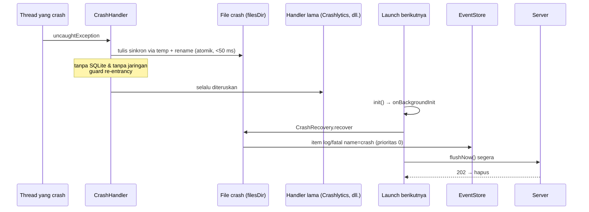
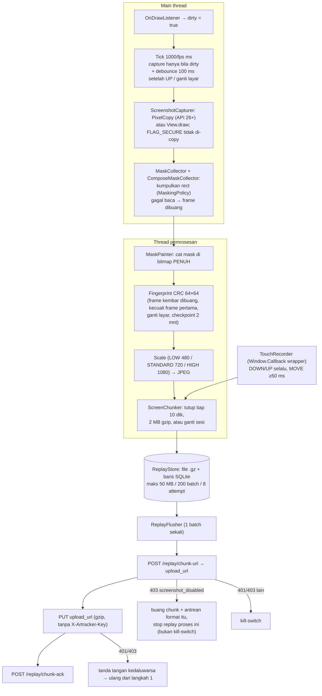
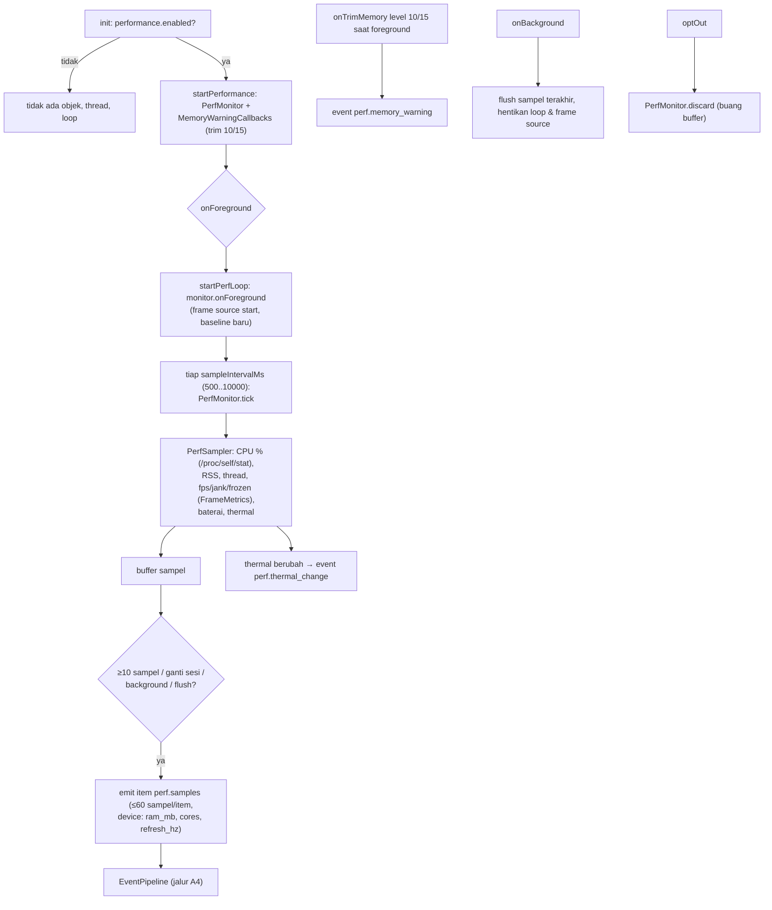

# Playbook & Flow — `artracker-sdk` (Android)

> Pelengkap `ARCHITECTURE.md` (desain & keputusan). Dokumen ini fokus pada **cara kerja saat runtime** (flow) dan
> **apa yang dilakukan** saat integrasi, debugging, dan rilis (playbook). Diagram memakai Mermaid.
> Sumber: kode `src/main/java/id/art/tracker/` (cabang `feature/session-profiling`), termasuk modul `perf/` yang belum
> ada di `ARCHITECTURE.md`.

---

## Bagian A — Flow

### A1. Gambaran besar



### A2. `ARTracker.init()` dan startup



### A3. Foreground / background



Di background **tidak ada** capture, timer, atau sampling perf. Hanya satu `OneTimeWorkRequest` bila ada yang tertunda.

### A4. Jalur event → server



Prioritas antrean: `0` crash/fatal (tidak pernah di-evict) → `1` log error → `2` event/session.
Batas penyimpanan: 5 MB / 5000 baris, item >7 hari dibuang.

### A5. Crash → terkirim pada launch berikutnya



Sumber lain: `ExitInfoCollector` (API 30+) mengirim `anr`, `native_crash`, dan `low_memory` dari sesi lalu lewat pipeline normal.

### A6. Session replay (screenshot ter-mask)



Governor: `ByteBudgetGovernor` membagi dua fps bila >5 MB / 60 dtk; bila masih lewat di fps minimum, kualitas turun satu preset. `FrameScheduler` menurunkan fps bila capture >16 ms tiga kali berturut-turut.
Gate awal: `replay.enabled = true` **dan** sampling deterministik `hash(session_id) < sampleRate`.

### A7. Session profiling (`perf/`, opt-in)



Catatan: `perf.memory_warning` tidak dikirim di Android 14+ (level trim 10/15 tidak lagi dikirim OS). Target overhead belum tercapai di emulator (commit `6f65348`, lihat `PERF.md`).

---

## Bagian B — Playbook

### B1. Integrasi di app host

1. **Dependensi**: `implementation("id.art.tracker:artracker-android:<versi>")` (GitHub Packages, butuh token `read:packages`). Kotlin host ≥ 2.0.x didukung (stdlib dipin 2.0.21).
2. **Init** di `Application.onCreate()` sedini mungkin (agar `CrashHandler` terpasang awal):
   ```kotlin
   ARTracker.init(this, ARTrackerConfig(
       endpoint = "https://…", apiKey = "art_live_…",   // wajib prefix art_live_
       environment = "production",
       replay = ReplayConfig(enabled = false),          // default off, opt-in
       privacy = PrivacyConfig(maskAllInputs = true),
       performance = PerformanceConfig(enabled = false) // default off, opt-in
   ))
   ```
3. **Opsional**: `ARTrackerOkHttpInterceptor()` (OkHttp harus ada di app), `ARTracker.trackNavController(nav)` atau `ARTracker.screen("…")` untuk Compose, `@ARTrackerScreenName`.
4. **Privasi**: tandai area sensitif dengan `artrackerMask()` / `Modifier.artrackerMask()` / `android:tag="artracker-mask"`; kelas kustom lewat `PrivacyConfig.sensitiveViewClasses`.
5. **Logout**: `ARTracker.reset()`. **Consent**: `ARTracker.optOut(true)` (membersihkan antrean & berhenti merekam).
6. **ProGuard/R8**: `consumer-rules.pro` sudah menangani; tidak perlu `-keep` manual untuk facade.

Kontrak yang harus dijaga: semua API publik no-op sebelum `init()`, tidak pernah melempar exception ke app.

### B2. Verifikasi cepat setelah integrasi

| Cek | Cara | Hasil yang diharapkan |
| --- | --- | --- |
| SDK hidup | `ARTracker.diagnostics()` (panel di `DiagnosticsScreen` sample app) | pending count, status kirim terakhir, kill-switch |
| Event tiba | `ARTracker.track("x")` lalu `ARTracker.flush()` | `202` di debug log; item muncul di `GET /projects/:id/events` |
| Offline queue | Mode pesawat → `track` beberapa kali → online | item terkirim sendiri (WorkManager / init berikutnya) |
| Crash | Tombol *Crash now* → buka ulang app (online) | item `log/fatal` `name=crash` tiba |
| Masking | Layar Login/Payment sample app dengan `replay.sampleRate = 1.0` | kolom password/kartu tertutup pola silang di dashboard |
| Profiling | `PerformanceConfig(enabled = true)`, foreground 30 dtk | item `perf.samples` (3 batch pada interval 1 dtk) |

Selalu aktifkan `debug = true` saat verifikasi supaya `SdkLog` tampil.

### B3. Troubleshooting (gejala → penyebab → tindakan)

| Gejala | Kemungkinan penyebab | Tindakan |
| --- | --- | --- |
| Tidak ada data sama sekali | `init()` belum dipanggil / key bukan `art_live_*` / kill-switch 401 aktif / opt-out | Cek `diagnostics()`; kill-switch bertahan 1 jam (persisted); `optOut(false)` bila perlu |
| Berhenti kirim setelah `401` | Key salah/dicabut | Perbaiki key; tunggu `disabledUntil` atau hapus data app saat uji |
| Data lambat muncul | Di background hanya WorkManager (tunda OS) | Normal; `flush()` saat foreground untuk uji |
| `429` terus | Kuota project 1000 event/s dibagi semua device | Turunkan sampling replay/perf, kurangi event berisik |
| Replay kosong | `enabled=false`, sesi tak lolos sampling, `403 screenshot_disabled`, backend lama (`404` → batch dibuang) | Cek config + `sampleRate`; cek setting project; upgrade backend |
| Replay berhenti setelah kill-switch 401 pulih | Batasan diketahui: tidak auto-resume saat tetap foreground | `startReplay()` atau relaunch |
| Area layar hitam/silang tak terduga | `SurfaceView`/`TextureView`/`WebView`/map/`FLAG_SECURE` selalu di-mask | Perilaku by design |
| Crash tidak terkirim | App di-kill sebelum file ditulis (>50 ms) atau belum relaunch | Relaunch online; cek file `filesDir/artracker/crash/` |
| `perf.memory_warning` tidak muncul | Android 14+ tidak mengirim trim level 10/15 | Batasan platform |
| Custom `ARTrackerSender`, replay gagal | Sender selalu `POST` / tanpa body response | Dukung `method` (`PUT`) dan `body` (lihat KDoc, R6) |
| Request SDK muncul di Chucker/OkHttp | Memakai `NetworkConfig.sender` kustom | Disengaja; interceptor melewati host endpoint |

### B4. Runbook perubahan kode

| Mau mengubah… | Mulai dari | Jangan lupa |
| --- | --- | --- |
| Event/atribut baru | `ItemFactory`, `core/ARTrackerCore.kt` | Taksonomi `ARCHITECTURE.md §11`, batas atribut 24 KB, redaksi |
| Aturan masking | `privacy/MaskingPolicy`, `ViewMaskRules`, `ComposeMaskRules` | Fail-closed; tes Robolectric per inputType/tag/subtree |
| Respons status baru | `transport/Flusher`, `ReplayFlusher`, `SendResult` | Tes kontrak `MockWebServer`, tabel di `ARCHITECTURE.md §2` |
| Metrik perf baru | `perf/PerfSampler`, `PerfSample`, `PerfMonitor` | Bump `v` di payload bila bentuk berubah; ukur overhead (`PERF.md`) |
| Config baru | `ARTrackerConfig` | Constructor default Kotlin berubah → catat di CHANGELOG (host Kotlin perlu rekompilasi) |
| Dependensi baru | `build.gradle.kts` | Opsional ⇒ `compileOnly` + `ClassAvailability`; hindari memaksa versi ke app host |

Prinsip tetap: tidak crash/lambat app host (`runCatching` di tiap entry point), main thread hanya membaca View dan komposit window, masking sebelum scale/JPEG.

### B5. Checklist rilis

1. `CHANGELOG.md`: pindahkan `[Unreleased]` ke versi baru; catat perubahan breaking (mis. constructor `ARTrackerConfig`).
2. Naikkan versi SDK (`SDK_VERSION`/`build.gradle.kts`).
3. Jalankan tes JVM + Robolectric: `./gradlew :artracker-sdk:testDebugUnitTest`.
4. `scripts/verify-publication.sh` (repo Maven lokal terisolasi + consumer app percobaan).
5. Tag `vX.Y.Z` → `.github/workflows/publish.yml` mempublikasikan ke GitHub Packages (lihat `docs/releasing.md`, `docs/github-packages.md`).
6. Sinkronkan `ARCHITECTURE.md` dan dokumen ini bila ada flow yang berubah.

### B6. Utang verifikasi (belum dijalankan)

- Tes instrumentasi: crash offline → relaunch (acceptance criteria #2).
- Macrobenchmark/Perfetto: CPU background <1%, `init` ≤2 ms (kriteria #1); overhead profiling di emulator belum memenuhi target (`PERF.md`).
- Pemutaran chunk screenshot di dashboard dan E2E ke backend lokal (`docs/e2e-manual-test.md`).
- `ARCHITECTURE.md` belum memuat modul `perf/` (item `ItemType.PERF`, `perf.*`): perlu ditambahkan bersama merge cabang ini.
- POM belum punya lisensi (repo belum punya `LICENSE`).
